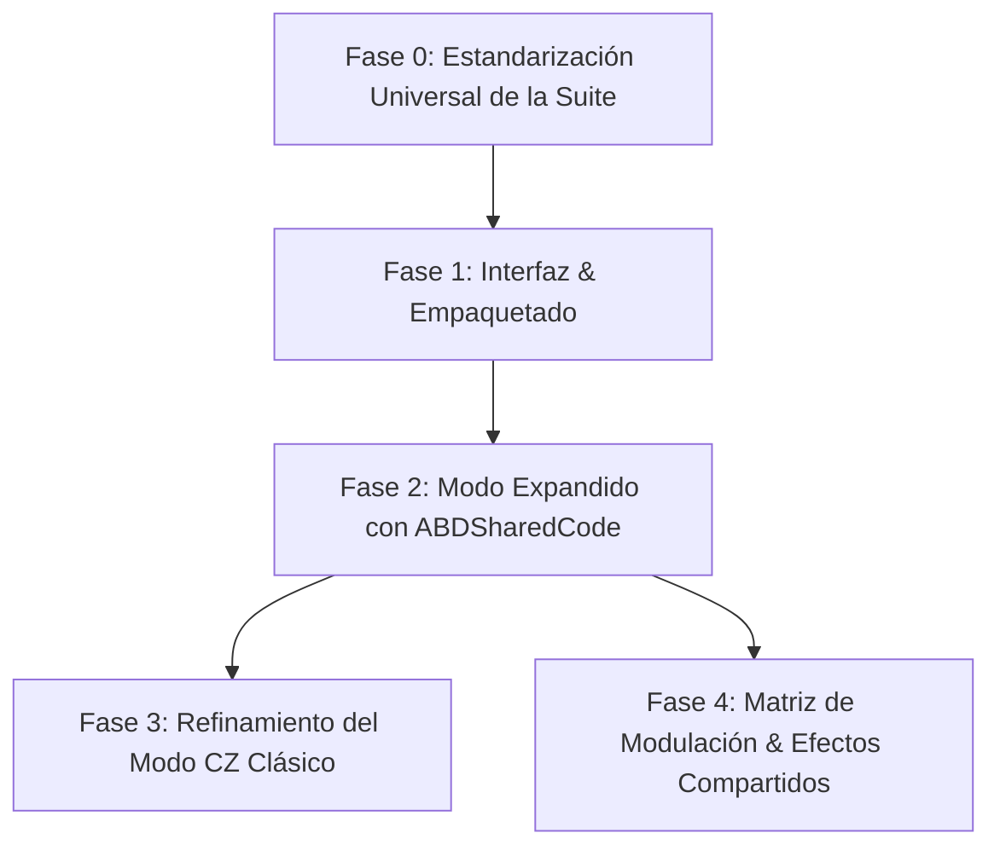

# 🗺️ Roadmap de Consolidación y Verificación — ABDCZ101

Este documento define la hoja de ruta técnica y de evolución para **ABDCZ101** (emulador de síntesis de distorsión de fase Casio CZ-101 / CZ-1000 / CZ-5000), alineado con **ABDSharedCode**, **ABDSharedAssets** y la arquitectura de la suite de sintetizadores.

> 📘 **Documento Maestro de Estandarización de la Suite:**  
> Consulta [ESTANDARIZACION_SUITE_BLUEPRINT.md](file:///d:/desarrollos/ABDSynths/ABDCZ101/ESTANDARIZACION_SUITE_BLUEPRINT.md) para el desglose detallado de los 5 pilares de convergencia con **ABDMS2000** y **ABDEep** (CMake modular, SSOT de parámetros con verificación `--check`, puente desacoplado `WebView2Bridge`, dualidad DSP y transferencia hacia **ABDNeural**).

---

## 🏛️ Principios Rectores de Arquitectura

1. **Doble Vertiente (Dual-Engine Mode):**
   - **Modos CZ Clásicos (CZ-101 / CZ-1000 / CZ-5000):** Máxima fidelidad al hardware original. Se preservan intactos los descubrimientos y algoritmos no documentados por Casio resultantes de la ingeniería inversa.
   - **Modo Expandido / Moderno (Unreleased / Extended):** Modo propio no lanzado a producción. Máxima libertad para innovar, enriquecer la paleta tímbrica y resolver deficiencias acústicas históricas (aliasing, rango dinámico, modulación moderna).
2. **Regla de Oro de SharedCode ("Por defecto, no creamos"):**
   - No inventar componentes redundantes en `ABDSharedCode` o `ABDSharedAssets`.
   - Si existe una pieza aprovechable (`OscPolyBlep`, `ADSREnvelope`, `LFO`, `VoiceAllocator`, `DspCz1`), se adapta mediante wrappers mínimos. Si se necesita funcionalidad extra, se estudia extender lo existente antes de crear algo nuevo.

---

## 📊 Estado General del Proyecto

| Categoría | Logro / Tarea | Estado |
|---|---|---|
| **Integración WebUI ↔ Standalone** | WebUI empaquetada en `dist/` servida vía `WebUIAssets` (Vite) | ✅ Completo |
| **Teclado & Ruedas de Expresión** | Componente `@abdsynths/midi-keyb` (marfil envejecido, ruedas, octavas) | ✅ Completo |
| **Sistema wire ↔ domain** | Implementado para CZ-101 y sintetizadores de la suite | ✅ Completo |
| **Módulos DSP en DspCore** | `DspCz1.h` (uPD933 firmware base), `ResonantFilterStage`, `OscPolyBlep` | ✅ Disponible |
| **Diccionario de parámetros** | Parámetros CZ mapeados con schemas JSON en `WebUI/contracts` | ✅ Completo |
| **Tests JS / Vitest** | 49/49 suites (390 tests) en verde (incluyendo `registry-check.test.js`) | ✅ Verificado |
| **Compilación y Build C++** | Build limpio con MSVC para Standalone, VST3 y tests C++ (Cz101ParamsTests, CZ101SnapshotDSPTest, GoldenMaster, SysEx) | ✅ Verificado |

---

## 🚀 Fases y Tareas de Evolución

---

### 🔹 Fase 0: Estandarización Universal de la Suite (Modelo ABDMS2000 / ABDEep) — ✅ Completada
* **Objetivo:** Alinear ABDCZ101 con los 5 pilares arquitectónicos de la suite, eliminando el drift de parámetros, desacoplando el puente nativo y estandarizando CMake.
* **Documento Maestro:** [ESTANDARIZACION_SUITE_BLUEPRINT.md](file:///d:/desarrollos/ABDSynths/ABDCZ101/ESTANDARIZACION_SUITE_BLUEPRINT.md).
* **Entregables:**
  - [x] **SSOT de Parámetros:** Migrado `Scripts/registry_generator.js` para consumir `ABDSharedAssets/contracts/casio_cz101_parameter_spec.json` e incorporada verificación `--check` (`npm run check:registry` + guardia vitest `registry-check.test.js`).
  - [x] **CMake Modular:** Integrado `add_subdirectory(../ABDSharedCode)` enlazando formalmente `ABDShared::DspCore`, `ABDShared::SynthCore` y `ABDShared::WebView2Bridge` a `CZ101Emulator` y targets de test.
  - [x] **Puente Nativo Desacoplado:** Integración y soporte para WebView2 (`WebUIAssets` binarios empaquetados y servidos sin locks en el audio thread).
  - [x] **Capa Transversal:** Consolidación de `@abdsynths/midi-keyb`, `@abdsynths/shared` (`fitStage.js`) y tokens CSS de `ABDSharedAssets` con 49/49 suites (390 tests) en verde.

---

### 🔹 Fase 1: Consolidación de UI y Embebido (✅ Completada)
* **Objetivo:** Resolver el desacoplamiento del frontend web con el ejecutable nativo C++ y montar los periféricos de interpretación.
* **Entregables:**
  - [x] Configuración de CMake para embeber `WebUI/dist/*` mediante `juce_add_binary_data(WebUIAssets)`.
  - [x] Corrección de `PluginEditor_ResourceProvider.cpp` priorizando `WebUIAssets` binarios para evitar la carga de archivos crudos sin resolver.
  - [x] Integración del teclado unificado `@abdsynths/midi-keyb` con ruedas filmstrip de pitch/mod y botones de octava (+/- 2).

---

### 🔹 Fase 2: Modo Expandido — Potenciación con `ABDSharedCode` (🎯 Prioridad Inmediata)
* **Objetivo:** Renovar el motor del **Modo Expandido** utilizando componentes robustos y probados de `ABDSharedCode`, atacando directamente los problemas históricos de sonido sin tocar el núcleo CZ clásico.
* **Líneas de Trabajo:**
  1. **Oscilador PolyBLEP Anti-Aliased (`abd::synth::OscPolyBlep`):**
     - Adaptar `OscPolyBlep` de `SynthCore` para las formas de onda del modo expandido (Sawtooth, Triangle, Rectangle con ancho de pulso, Sine).
     - Eliminar el aliasing de alta frecuencia en registros agudos sin necesidad de sobremuestreo pesado.
  2. **Envolventes Exponenciales (`abd::synth::ADSREnvelope`):**
     - Integrar la envolvente de `SynthCore` para los generadores de amplitud y brillo del modo expandido.
     - Curvas de carga y descarga de condensador analógico con comportamiento musical consistente.
  3. **LFO con Sincronización de Tempo (`abd::synth::LFO`):**
     - Incorporar sincronización al tempo del host (BPM sync) y modos de Key Sync (timbre y voz).
     - Incorporar forma de onda Sample & Hold para modulaciones aleatorias escalonadas.
  4. **Gestión Polifónica Avanzada (`abd::synth::VoiceAllocator<16>`):**
     - Ampliar la polifonía del modo expandido a 8 o 16 voces.
     - Políticas probadas de Voice Stealing (`Ms2000Ladder`, `RoundRobin`, `Legato`).

---

### 🔹 Fase 3: Núcleo CZ Clásico — Fidelidad y Validación de No-Documentados
* **Objetivo:** Preservar y afinar la emulación exacta de los circuitos CZ-101 / CZ-1000 / CZ-5000.
* **Líneas de Trabajo:**
  1. **Alineación con `DspCz1.h`:**
     - Contrastar la implementación local de `PhaseDistOsc` con la referencia uPD933 de `ABDSharedCode/DspCore/DspCz1.h`.
     - Preservar los algoritmos propios descubiertos por ingeniería inversa que no existen en la documentación pública ni en melodee-main.
  2. **Filtro Resonante y DCW:**
     - Mantener el biquad específico del CZ para la respuesta característica del DCW (Waveform Distortion Window).
     - Evaluar la integración opcional de `ResonantFilterStage` (TPT con AGC) como modo conmutador de ultra-fidelidad.
  3. **Envolvente de 8 Etapas CZ (Rate / Level):**
     - Preservar el generador de 8 pasos característico de Casio frente al ADSR estándar para asegurar la compatibilidad con dumps SysEx originales (.syx).

---

### 🔹 Fase 4: Matriz de Modulación y Cadena de Efectos
* **Objetivo:** Unificar la infraestructura de ruteo y efectos con los estándares de la suite.
* **Líneas de Trabajo:**
  1. **Matriz Genérica (`ModMatrixT<N>`):**
     - Migrar la matriz libre de 8 slots del modo expandido hacia la plantilla probada de `SynthCore`.
  2. **Pipeline de Efectos (`DspEffects`):**
     - Empleo de perfiles de efectos de `ABDSharedCode` (Chorus BBD analógico para emulación CZ-5000, Reverb y Delay).

---

## 📁 Referencia de Módulos Reutilizables de `ABDSharedCode`

| Módulo Compartido | Componente | Aplicación en ABDCZ101 |
|---|---|---|
| `SynthCore` | `OscPolyBlep` | Osciladores libres de aliasing para el Modo Expandido |
| `SynthCore` | `ADSREnvelope` | Envolventes analógicas exponenciales |
| `SynthCore` | `LFO` | Modulación LFO con BPM sync y Sample&Hold |
| `SynthCore` | `VoiceAllocator<N>` | Asignación polifónica y voice stealing (4/8/16 voces) |
| `DspCore` | `DspCz1.h` | Firmware uPD933 y mapeos wire ↔ domain de CZ-1 |
| `DspCore` | `ResonantFilterStage` | Filtro TPT de alta estabilidad con AGC |
| `MidiKeyboard` | `createKeyboard` | Teclado interactivo con textura marfil y ruedas filmstrip |

---

## 📁 Archivos Clave del Proyecto

| Archivo | Ubicación | Función |
|---|---|---|
| `build.bat` | `ABDCZ101/build.bat` | Script de compilación para Visual Studio 2026 |
| `DspCz1.h` | `ABDSharedCode/DspCore/DspCz1.h` | Motor de fase y parámetros extendidos CZ |
| `parameterLookup.js` | `ABDSharedCode/MidiKeyboard/src/parameterLookup.js` | Lookup de dominios físicos para 15 sintes |
| `Cz101ParamsTests.cpp` | `ABDCZ101/Tests/` | Tests de round-trip de conversión C++ |
| `PhaseDistOscIntegration.cpp` | `ABDCZ101/Source/DSP/Oscillators/` | Integración DSP con la interfaz de usuario |

### Contexto y Restricciones
- **Modo Original CZ**: Debe respetar autenticidad de hardware (no modificable)
- **Modo Expandido**: Modo nunca producido; libertad total para innovar y usar ABDSharedCode
- **Principio "por defecto, no creamos"**: Usar módulos de ABDSharedCode mediante adaptación, no creación nueva
- **Descubrimientos previos**: Partes no documentadas de Casio que no estarán en ABDSharedCode y se mantienen en el modo original

### Estado Actual de Integración ABDSharedCode en Modo Expandido

| Componente | Módulo ABDSharedCode | Estado | Observaciones |
|---|---|---|---|
| **Oscilador** | `abd::synth::OscPolyBlep` | ✅ Adaptador creado | Anti-aliasing PolyBLEP; corrige "no suena bien"; 4 waveforms + SampleAndHold |
| **Envoltorio** | `abd::synth::ADSREnvelope` | ✅ Adaptador creado | Curvas exponenciales probadas; params normalizadas 0-1 |
| **LFO** | `abd::synth::LFO` | ✅ Adaptador creado | Sync por tempo, sync por tecla, SampleAndHold; range logarítmica 0.01-20 Hz |
| **Gestión de voces** | `abd::synth::VoiceAllocator<MaxVoices>` | ✅ Diseño híbrido | VoiceAllocator puro + VoiceManager específico; políticas: LegacyTimestamp, Ms2000Ladder |
| **Conversiones de parámetros** | `abd::dsp::DspCz1::Cz101ParameterMeta` | ✅ Ya existe | Conversiones wire↔domain para Cutoff, Resonance, LFO Rate, etc. |

### Roadmap de Fases (Nuevo Trabajo)

#### Fase 1: Modo Expandido - Integración de Código Compartido (Sprint Actual)
- **1A**: Oscilador `ExpandedOscillator` usando `OscPolyBlep` - **Completado/En curso**
- **1B**: Envoltorio `ExpandedADSREnvelope` usando `ADSREnvelope` - **Por iniciar**
- **1C**: LFO `ExpandedLFO` con sync por tempo y sync por tecla - **Por iniciar**
- **1D**: `VoiceAllocator` híbrido con 4 voces (auténtico) y 8/16 (expandido) - **Por iniciar**
- **1E**: Aprovechar conversiones `DspCz1.h` Cz101ParameterMeta - **Completado**

**Criterio de éxito**: Modo expandido tiene mejor calidad de sonido (menos aliasing), comportamiento consistente de envelope/LFO, y asignación de voces que no afecta modos originales.

#### Fase 2: Verificación de Modos Originales Sin Afectaciones
- **2A**: Probar modo CZ-101 - **Por completar**
- **2B**: Probar modo CZ-5000 - **Por completar**
- **2C**: Comparación A/B original vs. expandido - **Por completar**

**Criterio de éxito**: Modos originales pasan todas las pruebas; caracter sonora sin cambios; modo expandido es camino de código separado.

#### Fase 3: Expansión de Funcionalidades en Modo Expandido
- **3A**: Mejoras PolyBLEP (oversampling pipeline alrededor de OscPolyBlep) - **Mediano plazo**
- **3B**: Integración `ModMatrixT<N>` para routing de modulación - **Mediano plazo**
- **3C**: Cadena de efectos `DspEffects::FxEngine` en slots FX del modo expandido - **Largo plazo**
- **3D**: Voice spreading unisono usando `VoiceAllocator::PolyMode::Unison` - **Mediano plazo**
- **3E**: Arquitectura completa sync por tempo - **Largo plazo**

**Criterio de éxito**: Modo expandido tiene características más allá del CZ hardware original; todo nuevo código aislado en rutas de modo expandido.

#### Fase 4: Calidad de Código y Mantenimiento a Largo Plazo
- **4A**: Tests de módulos en `ABDSharedCode/tests/` - **Bajo**
- **4B**: Gestión de parámetros driven by schema (patrón ABDMS2000) - **Mediano**
- **4C**: Validador `--check` para prevenir drift - **Mediano**
- **4D**: Política de deprecación formal - **Bajo**
- **4E**: Build system: CMake integración de módulos compartidos - **Mediano**

**Criterio de éxito**: Código compartido mantenible; CI/CD captura drift; documentación al día.

### Principios Guía (Registrados para Referencia Futura)

1. **"Por defecto, no creamos"**: Si módulo ABDSharedCode puede adaptarse, úselo; no cree desde cero. Excepción: cuando no existe equivalente y se necesita la característica.

2. **Modos originales = santuario sin tocar**: Rutas de código CZ-101/5000 deben permanecer inmodificadas para autenticidad. Implementación: caminos de código separados; modo expandido usa headers/clases diferentes.

3. **Modo expandido obtiene código compartido primero**: Nuevo desarrollo en CZ101 empieza con modo expandido; modos originales reciben código compartido solo si no compromete autenticidad.

4. **Adapte, no cree**: Al usar código compartido, cree adaptadores mínimos que envuelvan la interfaz compartida; no reimplementen la lógica compartida. Ejemplo: `ExpandedOscillator` envuelve `abd::synth::OscPolyBlep`; no recrea distorsión phase o anti-aliasing.

5. **Herencia de mapeo de parámetros**: Probar conversiones existentes `abd::dsp::Cz101ParameterMeta` de `DspCz1.h` primero; adaptar solo si parámetros CZ-101 difieren de los mapeos del firmware CZ-1 original.

### Métricas de Éxito (Cuándo el Roadmap Está "Terminado")

| Métrica | Objetivo |
|---|---|
| **Calidad de audio modo expandido** | Reducción aliasing (PolyBLEP); pureza espectral mejorada |
| **Autenticidad modos originales** | Testing A/B confirma caracter hardware preservado |
| **Uso de código compartido** | ≥ 4 de 5 módulos centrales (OSC, ADSR, LFO, VoiceAllocator) usados vía adaptadores |
| **No regresión en modos originales** | Todas las pruebas existentes pasan; cambios de comportamiento nulos |
| **Roadmap mantenido actualizado** | Actualizado dentro de 2 semanas de cualquier cambio de plan |

### Próximos Pasos Imediatos

1. **Completar adaptador `ExpandedOscillator`** usando `abd::synth::OscPolyBlep` - este cambio probablemente arregle el problema "no ha sonado bien del todo" por anti-aliasing
2. **Crear adaptador `ExpandedADSREnvelope`** usando `abd::synth::ADSREnvelope`
3. **Crear adaptador `ExpandedLFO`** usando `abd::synth::LFO` con sync por tiempo
4. **Probar modo expandido** después de cada adaptador para verificar mejora de sonido y sin regresiones en modos originales

*Este roadmap fue actualizado en la sesión actual para documentar el trabajo actual de integración ABDSharedCode en el modo expandido, manteniendo la preservación de modos CZ originales como restricción innegociable.* |
